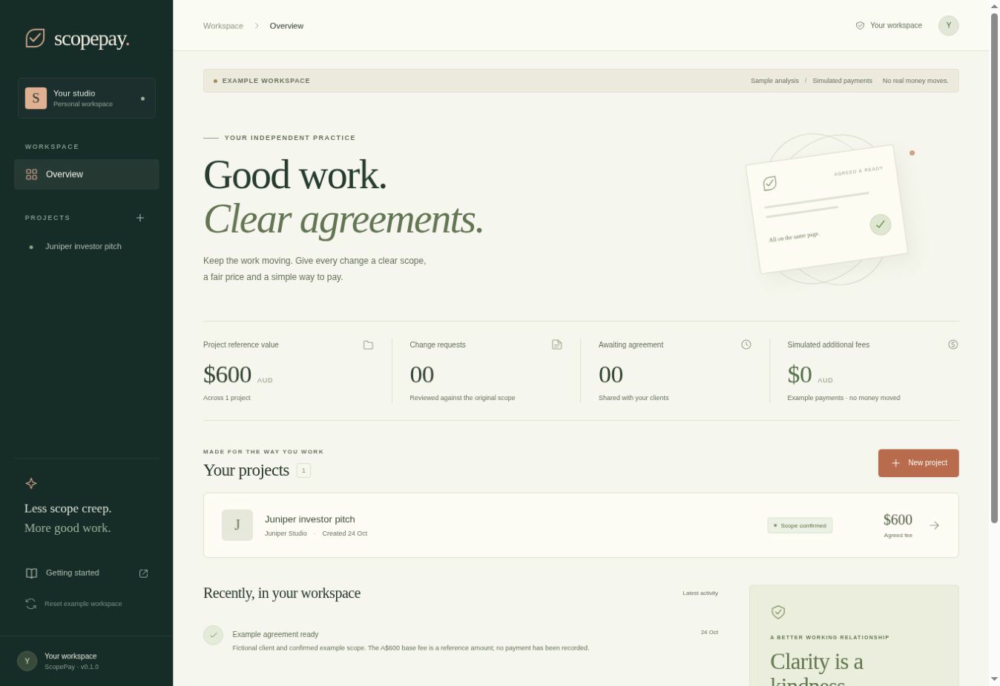
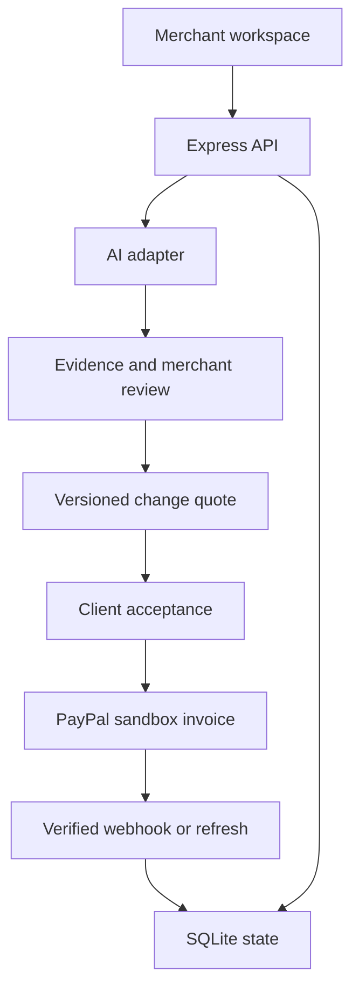

# ScopePay

**Clear changes. Confident payments.**

ScopePay helps freelancers turn a client's new request into an evidence-backed scope assessment, a reviewed change quote, and a PayPal sandbox invoice.



*Example workspace captured on 24 October 2026. Sample analysis and simulated payments are labelled in the interface; this screenshot does not demonstrate a connected AI model or a PayPal transaction.*

Built for the **Build What's Next with PayPal and AI** hackathon. Interface, examples and documentation use Australian English.

## The working story

A designer has agreed to deliver a 12-slide English pitch deck for A$600, including one revision round. The client asks for four extra slides, a Chinese version and a title change. ScopePay:

1. Compares the request with the confirmed scope and shows the supporting source text.
2. Separates included work, additional work and questions requiring clarification.
3. Lets the merchant review the classification and edit the quantities and prices.
4. Shares a fixed change quote through a private client review link.
5. Waits for client acceptance before creating a PayPal sandbox invoice.
6. Verifies and reconciles PayPal's invoice status, including partial and pending payments.

The example change is **A$360**: four additional slides at A$45 and one additional language version at A$180. The title change is included. These are fictional demonstration rates. The A$600 original fee is reference context, not a recorded payment.

## Run locally

Install **Node.js 24 LTS or newer** and npm. SQLite is provided by Node; no separate database service is required.

```bash
git clone https://github.com/FeidaWang/scopepay.git
cd scopepay
npm ci
cp .env.example .env
npm run dev
```

Open **http://localhost:3000**. Open the **Juniper investor pitch** project, select **Change requests**, and use **Run sample analysis** with the supplied request. Review the decisions and create a change quote. Open the client review link in another tab, accept the quote, return to the merchant tab and refresh, then create the invoice.

### Understand the two modes

| Component | Default: Example mode | Connected mode |
| --- | --- | --- |
| Analysis | Explicitly labelled deterministic example rules; no LLM call | Actual Ollama or compatible model request, schema validation and evidence checks |
| Payment | Explicitly labelled local invoice/payment simulation; no money moves | Actual PayPal **sandbox** API calls and buyer payment |
| Persistence | Local SQLite, isolated per browser session | The same persistent data model |

**Example mode is an interactive walkthrough, not evidence of live AI or PayPal integration.** A competition demonstration must configure a real model provider and PayPal sandbox, and show them working. Live providers never silently fall back to examples on failure.

## Enable real AI

### Local Ollama

Install [Ollama](https://ollama.com), select a suitable model for your hardware and start the Ollama service. For example:

```bash
ollama pull qwen3:8b
```

Set the following in your private `.env`, then restart ScopePay:

```dotenv
AI_PROVIDER=ollama
AI_MODEL=qwen3:8b
OLLAMA_BASE_URL=http://localhost:11434
```

Model availability, latency and extraction quality depend on your chosen model and hardware. Confirm the structured results before accepting a scope or quote. Ollama's local [structured output API](https://docs.ollama.com/capabilities/structured-outputs) is used; this does not assume its cloud API supports the same feature.

### Compatible hosted model

Use a provider that supports `/chat/completions` with strict JSON-schema structured output and `max_completion_tokens`:

```dotenv
AI_PROVIDER=openai-compatible
AI_BASE_URL=https://your-provider.example/v1
AI_MODEL=your-supported-model-id
AI_API_KEY=your-private-key
```

The URL and model above are placeholders. Model costs belong to your provider account. Keys remain on the server; they are never stored in the repository or sent to the frontend. A coding subscription is not used as the public application's model backend.

## Enable PayPal sandbox

Follow [PayPal setup](docs/PAYPAL_SETUP.md) for the complete seller, buyer, app and webhook steps.

```dotenv
PAYMENT_PROVIDER=paypal-sandbox
PAYPAL_CLIENT_ID=your-sandbox-client-id
PAYPAL_CLIENT_SECRET=your-sandbox-client-secret
PAYPAL_MERCHANT_EMAIL=your-sandbox-business-email
PAYPAL_WEBHOOK_ID=your-webhook-id
```

Use your actual **sandbox buyer email** when creating a new project for the live flow. The seeded Juniper address is fictional. The API base is deliberately fixed to `https://api-m.sandbox.paypal.com`; this project has no production-money mode.

Webhook endpoint: `POST /api/paypal/webhook`. A public HTTPS callback is required for incoming PayPal webhooks. The merchant **Refresh payment** action also reconciles the invoice directly. Set `APP_URL` to the application's exact public origin when deploying.

## Build, test and run

```bash
npm run typecheck
npm test
npm run build
npm start
```

`npm run check` runs type checking, the test suite and the production build. The tests include money arithmetic, invalid model output, evidence validation, invoice recovery, webhook verification, session isolation, stale quotes and the complete example workflow. Provider tests use mocked responses; they do not prove that a real account is connected.

The [verification record](docs/VERIFICATION.md) distinguishes automated checks, the browser-tested Example-mode workflow and connected-provider checks still to be performed.

### Docker

```bash
docker build -t scopepay .
docker run --rm -p 3000:3000 --env-file .env -v scopepay-data:/app/data scopepay
```

The named volume persists SQLite data. For a container deployment, configure an HTTPS endpoint supported by the compatible model adapter. Local Ollama over HTTP must share ScopePay's network namespace and be reachable on loopback, for example `http://127.0.0.1:11434`. See [deployment notes](docs/DEPLOYMENT.md).

## Architecture



- **Frontend:** React, TypeScript and Vite; responsive layout, keyboard focus states and explicit loading/error states.
- **Backend:** Express on Node.js 24; server-side validation, money in integer cents and controlled payment operations.
- **Persistence:** SQLite in WAL mode; per-workspace serialisation protects concurrent mutations. Run one application process against the local database.
- **AI:** Extracts scope and compares change requests. Unknown evidence, rates or scope references require clarification. Financial actions are not exposed directly to the model.
- **PayPal:** Creates, enables and reads invoices; reconciles uncertain creation by a stable invoice number. Verifies webhooks before updating local records.
- **Access:** Each browser gets an isolated workspace through an HttpOnly session cookie. Client review links are random capabilities. This is a single-merchant sandbox prototype, not an account-based, multi-tenant production SaaS.

For the exact data boundaries, see [architecture](docs/ARCHITECTURE.md).

## Project guide

| Path | Purpose |
| --- | --- |
| `src/` | Merchant workspace and client review interface |
| `shared/types.ts` | Shared API and domain types |
| `server/ai.ts` | Structured model integrations and explicit example rules |
| `server/domain.ts` | Quote arithmetic and validation |
| `server/paypal.ts` | Sandbox-only PayPal integration |
| `server/app.ts` | API, review links, CSRF and workflow transitions |
| `server/store.ts` | SQLite persistence and workspace locking |
| `tests/` | Behavioural and integration tests |
| `docs/VERIFICATION.md` | Dated verification results and the limits of what was tested |
| `docs/DEMO_SCRIPT.md` | Under-three-minute demonstration plan |
| `docs/SUBMISSION.md` | Draft Devpost description and outstanding submission steps |

## Current boundaries

This version supports AUD, one sandbox merchant and supplemental change invoices. It does not collect the original project fee, hold funds in escrow, automatically charge buyers, handle disputes, or onboard third-party merchants. The merchant must approve a quote, and the client must accept it before an invoice is created. User accounts, email delivery, tax calculation and production payments are outside this prototype.

Connected AI and PayPal flows require your credentials and a real end-to-end verification. Do not publish private environment files, database files, buyer passwords or API keys. Provide judges with a hosted sandbox demo or complete setup instructions and privately supplied test access where necessary.

## Sources and tools

- [PayPal hackathon rules](https://paypalaihackathon.devpost.com/rules)
- [PayPal Invoicing API](https://developer.paypal.com/api/invoicing/v2)
- [PayPal webhook verification](https://developer.paypal.com/api/rest/webhooks/rest/)
- [PayPal AI Toolkit](https://github.com/paypal/AI-Toolkit)
- [Ollama structured outputs](https://docs.ollama.com/capabilities/structured-outputs)

The implementation was prepared with ChatGPT/Codex assistance. The model used for product inference is whichever provider and model the operator explicitly configures. No sponsor tool is claimed as integrated unless it is actually present in the running build.

## Licence

[MIT](LICENSE). Original ScopePay identity and interface assets are included. PayPal is referenced to identify the integration; no PayPal logo assets or endorsement are claimed.
